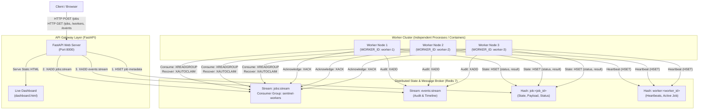
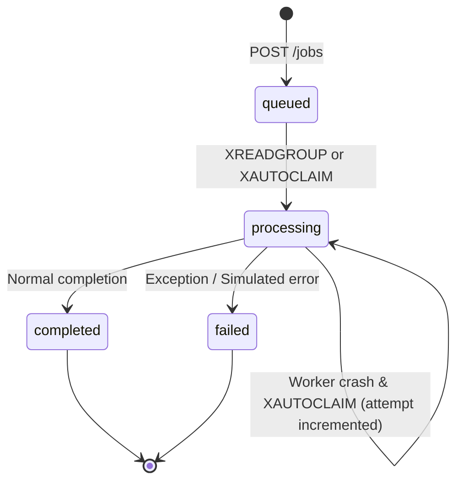
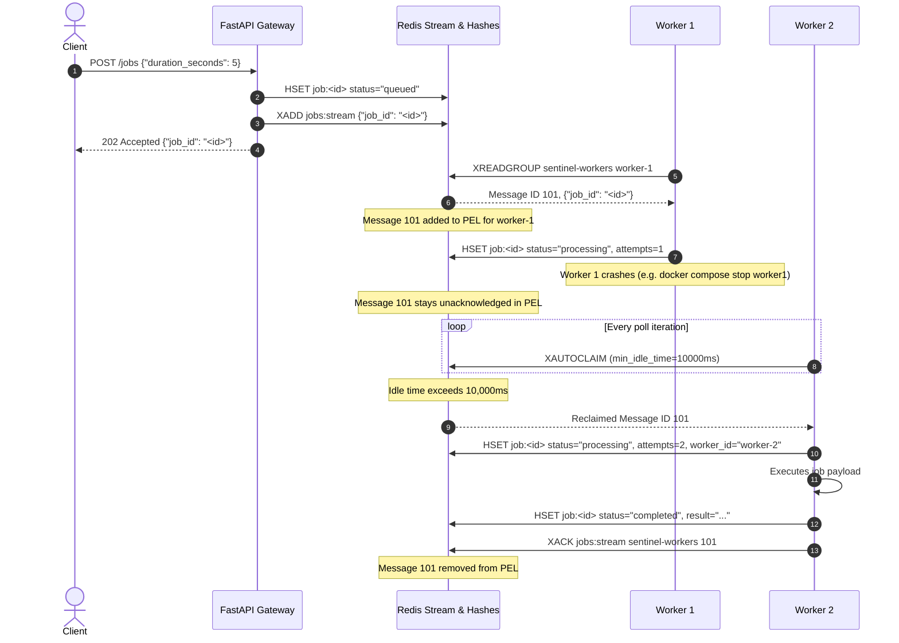

# SentinelMesh — Architecture & System Design Documentation

**SentinelMesh** is a distributed, fault-tolerant asynchronous task processing system designed to demonstrate core principles of distributed systems: asynchronous messaging, stream-based work distribution, dynamic consumer groups, heartbeat-driven failure suspicion, automatic recovery of pending tasks, and observability.

---

## 1. High-Level System Architecture

SentinelMesh uses a decoupled producer-consumer architecture mediated by an in-memory message broker and state store (Redis 7).



---

## 2. Core Components

### 2.1 API Gateway & Orchestrator (`app.py`)
- **Framework**: FastAPI (ASGI with Uvicorn).
- **Responsibilities**:
  - Exposes RESTful endpoints for job submission and status queries.
  - Generates unique UUIDv4 identifiers for each job.
  - Persists initial job metadata into Redis Hash `job:<jid>` before queuing to eliminate race conditions.
  - Pushes work to the Redis Stream `jobs:stream`.
  - Publishes audit events to `events:stream`.
  - Computes worker health status based on heartbeat timestamps during queries.
  - Serves the integrated single-page dashboard.

### 2.2 Distributed Worker Nodes (`worker.py`)
- **Runtime**: Autonomous Python processes running in separate Docker containers.
- **Identity**: Configured via `WORKER_ID` environment variable (e.g., `worker-1`, `worker-2`, `worker-3`) or falling back to `<hostname>-<uuid>`.
- **Responsibilities**:
  - Initializes the shared consumer group `sentinel-workers` on `jobs:stream` (`ensure_group` with `id="0"`).
  - Emits regular heartbeats into Redis Hash `worker:<worker_id>`.
  - Periodically checks for abandoned/idle jobs using `XAUTOCLAIM` (min idle time: 10 seconds).
  - Pulls new jobs using `XREADGROUP` with blocking timeout (1.5 seconds).
  - Updates job execution state (`processing` &rarr; `completed` or `failed`).
  - Periodically sends heartbeats during job execution to avoid being suspected as dead during long tasks.
  - Acknowledges successfully processed messages via `XACK`.

### 2.3 Redis 7 Storage Engine
Acts as three distinct primitives in this system:
1. **Message Broker / Stream Queue (`jobs:stream`)**: Distributed FIFO queue with consumer groups and Pending Entries List (PEL).
2. **Audit & Event Bus (`events:stream`)**: Append-only log of system transitions (`job_submitted`, `job_started`, `job_completed`, `job_failed`, `worker_started`).
3. **Key-Value / Hash Document Store**:
   - `job:<job_id>`: Stores comprehensive job lifecycle data.
   - `worker:<worker_id>`: Stores worker heartbeat timestamps and active job ID.

### 2.4 Live Operations Dashboard (`dashboard.html`)
- Built with Vanilla HTML/CSS/JS without external dependencies.
- Polls `/jobs`, `/workers`, and `/events` every 2 seconds.
- Aggregates counters (Queued, Processing, Completed, Failed).
- Renders live worker node status (`online` vs `suspected_down`) and recent execution logs.

---

## 3. Data Models & Redis Schemas

| Key / Stream | Type | Key Fields / Payload | Description |
| :--- | :--- | :--- | :--- |
| `jobs:stream` | Stream | `{"job_id": "<uuid>"}` | Ingestion stream for consumer group distribution. |
| `events:stream` | Stream | `{"kind": "<event>", "at": <timestamp>, ...}` | Real-time event log for observability and auditing. |
| `job:<job_id>` | Hash | `job_id`, `status`, `task_type`, `payload`, `created_at`, `attempts`, `worker_id`, `result`, `error`, `completed_at`, `failed_at` | Primary record of truth for a job. |
| `worker:<worker_id>` | Hash | `worker_id`, `last_seen`, `active_job` | Heartbeat record tracking worker liveness. |

### Job Status State Machine



---

## 4. Distributed Systems Concepts & Mechanisms

### 4.1 Concurrency & Work Partitioning
- **Redis Consumer Groups (`sentinel-workers`)**: Redis ensures that messages delivered via `XREADGROUP` to the consumer group are partitioned among active consumers. No two workers receive the same new message concurrently.
- **Horizontal Scalability**: Additional workers can be attached to the consumer group dynamically without restarting or reconfiguring existing workers.

### 4.2 Liveness & Failure Suspicion
- **Heartbeat Mechanism**:
  - Idle workers update `worker:<worker_id>` with their current timestamp on each polling loop.
  - Active workers processing long-running jobs update their heartbeat every 0.5 seconds in a processing loop.
- **Failure Detection Threshold**:
  - The API Gateway checks the elapsed time: `age_seconds = now - last_seen`.
  - If `age_seconds >= 8.0s`, the worker is marked as `suspected_down` (failure suspicion, not certainty, following standard partial-failure models).

### 4.3 Fault Tolerance & Auto-Recovery (`XAUTOCLAIM`)
- **Pending Entries List (PEL)**: When a worker fetches a message via `XREADGROUP`, Redis moves the message into the consumer group's PEL. It remains pending until explicitly cleared via `XACK`.
- **Crash Scenario**: If a worker crashes, is stopped (`docker compose stop worker1`), or loses network connectivity mid-job, the message remains in the PEL with an increasing idle time.
- **Reclamation Protocol**:
  1. Other active workers invoke `r.xautoclaim(STREAM, GROUP, WORKER_ID, min_idle_time=10000, start_id="0-0", count=1)`.
  2. Any message pending for &ge; 10 seconds is atomically transferred to the reclaiming worker.
  3. The reclaiming worker inspects the job hash, increments `attempts`, and executes it.
  4. Upon completion, the reclaiming worker calls `XACK`, removing it from the PEL.



### 4.4 Delivery Semantics & Idempotency
- **At-Least-Once Delivery**: Because unacknowledged messages can be reclaimed via `XAUTOCLAIM`, SentinelMesh guarantees at-least-once delivery.
- **Implications for Idempotency**:
  - If a worker crashes after completing a task's external side effect but before executing `XACK`, another worker will reclaim the job and execute it a second time.
  - To prevent inconsistent state in production systems, tasks should use idempotent execution keys, database unique constraints, or two-phase commits.

---

## 5. API Endpoints Reference

| Endpoint | Method | Description | Response Codes |
| :--- | :--- | :--- | :--- |
| `/` | `GET` | Serves the operational monitoring web dashboard | `200 OK` |
| `/health` | `GET` | Health check verifying Redis connectivity via `PING` | `200 OK`, `503 Service Unavailable` |
| `/jobs` | `POST` | Submits a new task (`task_type`, `payload`) | `202 Accepted` |
| `/jobs` | `GET` | Lists recent jobs sorted by creation time | `200 OK` |
| `/jobs/{jid}` | `GET` | Retrieves full state and metadata for a specific job | `200 OK`, `404 Not Found` |
| `/workers` | `GET` | Lists all known workers, last seen age, and health status | `200 OK` |
| `/events` | `GET` | Returns recent system events from `events:stream` | `200 OK` |

---

## 6. Docker Compose Service Topology

The system runs across multiple isolated containers connected via a shared default bridge network:

```yaml
services:
  redis:      redis:7-alpine (port 6379, container healthcheck)
  api:        FastAPI + Uvicorn (port 8000, depends on redis healthy)
  worker1:    worker.py (WORKER_ID: worker-1, depends on redis healthy)
  worker2:    worker.py (WORKER_ID: worker-2, depends on redis healthy)
  worker3:    worker.py (WORKER_ID: worker-3, depends on redis healthy)
```

---

## 7. Known Limitations & Production Enhancements (Viva Discussion Points)

| Feature | Current MVP Implementation | Production Recommendation |
| :--- | :--- | :--- |
| **Atomicity** | Job Hash updates and Redis Stream `XACK` are separate operations. | Use Redis Lua scripts or multi-exec transactions for atomic state change and stream ack. |
| **Dead-Letter Queue (DLQ)** | Jobs that repeatedly throw exceptions are marked failed only if the worker process doesn't crash. | Implement a maximum delivery attempt count; route unprocessable poison messages to a DLQ after $N$ attempts. |
| **Failure Certainty** | Heartbeat expiration indicates *suspicion* (node could be in GC pause or overloaded). | Use distributed consensus (Raft, ZooKeeper, or etcd leases) for strict membership and leader lease management. |
| **Persistence** | In-memory Redis without persistent volumes. | Configure Redis AOF (Append-Only File) or RDB snapshots with persistent volume mounts. |
| **High Availability** | Single Redis instance (single point of failure). | Deploy Redis Sentinel for automatic failover or Redis Cluster for partitioned horizontal scaling. |
